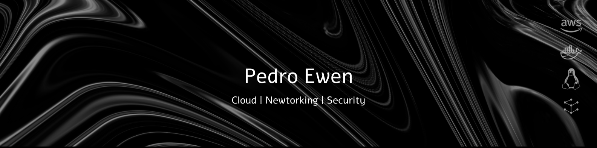

    &nbsp;&nbsp;
    &nbsp;&nbsp;
    

## Pedro Ewen

Desenvolvo em Python, com foco em segurança ofensiva e em ferramentas que resolvem problemas do dia a dia: avaliação de superfície de ataque, automação e aplicações web.

## Stack

  
  
  
  
  
  
  
  

## Projetos

- **[ManaTime](https://github.com/newe-x/manatime)**: junta as agendas de várias contas de trabalho (Google Workspace, Microsoft 365) num só painel, com to-do e pomodoro. FastAPI, Playwright e Docker.
